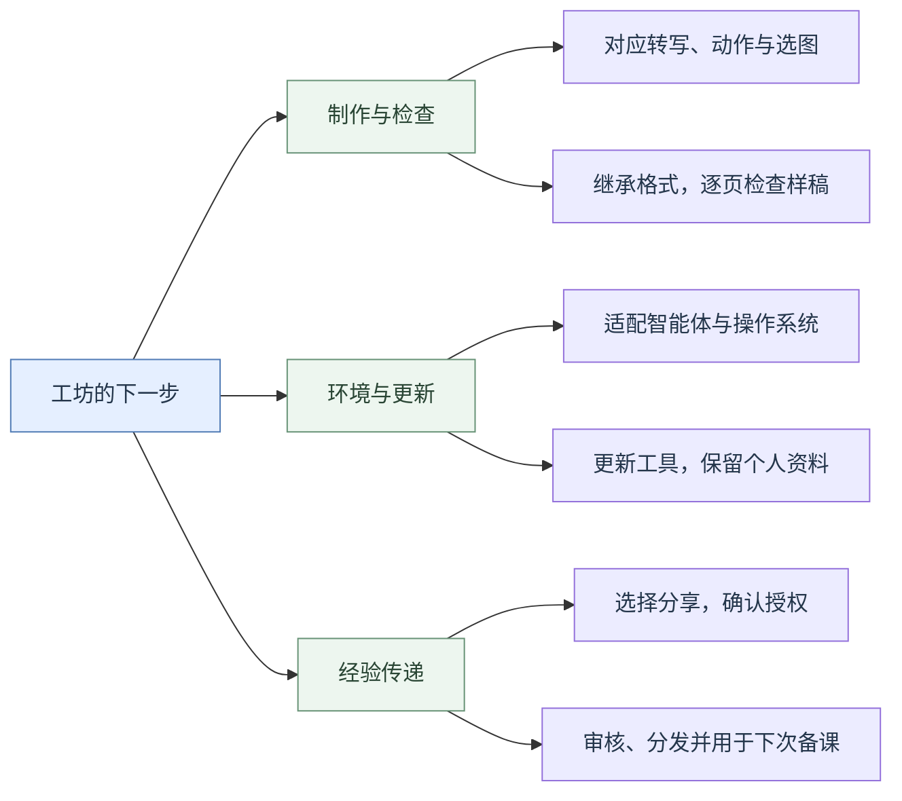

# 开发参与与改进路线

## 🛠️ 怎样参与3.x.x更新

参与者可按各自经验认领工作：开发志愿者维护代码、说明、测试和发布；手语老师审核表达与教学内容；资料协调人员收集材料、沟通授权。具体负责人仍需协商。

**提问题 → 开分支修改 → 验证并提交PR → 审核合并 → 打包发布。**

1. 在[Issues](https://github.com/LuckytoeUSTC/sign-song-agent/issues)或[邮件](mailto:liqiding@mail.ustc.edu.cn)里说清问题、复现条件和修改范围。架构、目录或输入格式的变化，先讨论方案与兼容办法。
2. 先Fork仓库（在自己的GitHub账号下创建仓库副本），再创建分支修改。阅读AGENTS.md、scripts/TOOLING.md及相关实现；通用制作沿用make_handout.py入口，各首歌的内容和格式分别放在制作数据与版式配置中。使用说明写老师怎样提出任务、选择和反馈；AGENTS.md写智能体怎样执行，TOOLING.md写工具用法。
3. 用专门编写的小型示例验证功能，排版改动逐页看预览，再向原仓库提交Pull Request（简称PR），请维护者查看修改前后的差异并决定是否合并。写明改动、验证结果和兼容限制；提交范围限于有关源码、说明与测试材料。
4. 技术维护者审核代码与测试；手语、授权问题交相应人员确认。发布前分别检查完整包和覆盖包，核对各自的兼容代码、适用版本、附件内容与操作说明。

### 目前发布方式：完整包与覆盖包并行，一个妥协

最初希望能更新程序和公共资料，同时保留每位老师自己的修改。但新增规则、修订讲义、改目录时，都可能碰到用户改过的文件，怎样安全合并还没想清楚。

所以3.1.1先做了一个折中：**老用户用覆盖包，只更新指定的工具和说明，继续使用原项目；新用户用已整合更新的完整包。** 覆盖前备份，检查成功后由老师决定是否保留备份，省去搬迁整个工作台和资料的麻烦。

后来为精简完整版，移除了旧制作格式和覆盖更新接管代码；覆盖包仍需保留这些功能，两种包就有了不同代码，修复时需要分别维护、验证。**这个办法照顾了眼前的使用，但怎样统一维护、怎样更新公共资料又保留个人修改，仍需解决。**

发布沿用README的版本约定，写清各包适用于哪个旧版本、替换什么、怎样恢复。程序版本与制作数据格式分别记录；首页介绍可单独更新，影响安装与更新的纠错要同步处理附件。

## 🗺️ 后续改进路线

以下是基于几次备课测试提出的改进方向。理想目标见[README](README.md)，具体实现留待参与者讨论和验证。

## 🔎 几次测试留下的教训

### 读了资料，还要能用到下一句

早期《吉量》初稿中，智能体对专有名词怎样使用指拼、特殊动作怎样用文字说明，都缺少具体可用的处理。后来完整阅读参照讲义、继续查词，再由老师指导具体表达，才逐步形成方案。

到了《起风了》，已经有完整参照阅读和案例检索记录，但一些困难句仍只留下笼统的来源。比如已有案例讨论过“不论／不管”的使用区别，新稿表达“随缘”时仍选用了“不论”，却没有交代这次选择与旧案例有什么联系。另有一句“翻过岁月不同侧脸”被处理为“岁月／经历／变化”，三个词都与原句相关，但谁经历了什么、什么发生变化，仍需说明。

**要传下去的是选择的理由和适用条件。** 每条经验最好留下原句、原方案、老师采用的方案，以及为什么改；新歌遇到类似问题时，检索到案例，再回看有关原件，说明本句与旧例相同和不同的地方。完整讲义帮助理解整体表达，数据库帮助定位具体问题，两者配合使用。

### 分清词、动作过程和图片用途

《起风了》有一句“迈出车站的前一刻”。讲义注释安排的动作是：用“走”表示从站内向站外移动，迈出前停住。但AI另外放入了“停止”的手势图解，读者可能因此在走路动作之后，再打一次独立的“停止”。按注释选定的方案，只需让走路动作停在相应位置；转写、手势图解和注释应共同表达这一过程。

这句话中的“车站”还有另一项选择：词典原图先画汽车方向盘，再画站立动作；词条说明允许表示火车站时把首个动作换成“火车”。AI据此选用“火车”和“站立”的手势图解。老师起初对站立表示车站不习惯，核对后认可它有词典依据、可以接受。整理经验时，应分别记下词典依据和老师的个人偏好，让后来的使用者知道有哪些可选表达。

制作记录需要能回答几个具体问题：选了什么词、实际用图片的哪部分、方向或动作怎样组织、哪些短提示要印给学生。老师据此修改后，转写、选图和注释要一起更新。

### 格式习惯要落到数据和页面

3.1.0的《吉量》试排中，AI自行给手势图解加上中文词名；3.1.1的《起风了》已去掉这些标签，却又漏填借图标记：程序支持用虚线框提示只供参考的图，制作数据里没有填写，成稿就完全没有框。转写斜体的范围也含糊，同组动作的图解被换行拆开；字号和图高则由智能体另选参数，与参照讲义不同。

后续应先整理一份可复用的参照配置，再记录本次差异。在配置中写清字体和图高，在制作数据中标明注释对应哪张图、重复段是否省图；虚线框与斜体按本社群及本曲约定使用。对特别扁的图片，可在上下补白，调节同一行中手形的视觉大小；同组动作尽量排在一起。这些要求可以用页面样例说明，再由程序落实、逐页核对。

### 检查通过，要知道检查了什么

诊断测试中，删除样稿原本应有的斜体，再与原制作数据核对，检查仍报告通过。上文“走路过程停住”却选用独立“停止”手势图解的矛盾，也能通过检查，因为程序只核对成品是否与输入一致。下一步既要补齐可自动核对的标记和格式，也要给老师列出需要判断的表达问题。

保留几份专门用于测试的小型样稿，覆盖曾经出错的情况。代码或指令修改后，重跑相应检查；影响页面时查看预览；动作自然度和合歌效果由老师试打确认。这样，每次修复才会积累成下一次制作的可靠基础。

这些测试使用了不同歌曲，老师参与程度和允许AI自主推进的范围也不同。要比较版本本身的效果，还需在相同任务和条件下测试。

## 🌱 重点议题：怎样把细节经验与语感传下去

**这是联星老师最希望有人接力完成的功能。** 希望把老师掌握的细节经验写清楚，让换了老师、换了项目的智能体也能用上，减少对模型记忆上下文、自己提炼经验的依赖。

已有规则、例句、修改案例和检索工具，但从个人经验的输入，到审核、分享，再到下一次正确使用，还缺少顺畅的全过程。下面集中列出需要共同考虑的问题，以及已经比较明确的基础办法。

### 四个案例，说明经验为什么难传

- **“小马”被改成“马／小”。** 模型过度套用了学过的词序调整。怎样让它理解原规则的适用条件，并认出“小马”这种不能照搬的情况？
- **“上、下”可以用空间表达。** 对象的位置和运动有时已经表达上下关系。怎样记录具体的空间组织，让模型能比较是否还需要独立的方位词？
- **“在”可以因歌曲而省略。** 老师平时习惯打出“在”，快速、活泼、诗意的歌曲里却可能省略。怎样同时留下日常习惯和本曲取舍，让模型知道何时参考哪一种？
- **类标记有各自的使用习惯。** 用什么手形代表马或马车、哪只手表示谁、如何运动和配合，都会影响理解。怎样保存这些细节及示范，让其他老师和智能体读得懂？不同老师、社群的习惯怎样并存？

这些案例来自老师的实际反馈，整理时需核对原例的动作、场景和修改理由。可以先用它们检验经验传递，再逐步扩展。

### 从输入到调用，需要回答哪些问题

| 环节 | 需要共同考虑的问题 |
|---|---|
| 输入形式 | 老师口述、文字批注、对话修改、手势图解和示范视频怎样整理？哪些信息必须有，哪些可后补？ |
| 输入时机 | 修改一句、审核样句、讨论全曲、试打和课后反馈时，怎样顺手记录，又尽量少打断备课？ |
| 发现经验 | 怎样察觉可复用的经验？怎样区分旧经验的补充、新建议和本曲选择？遇到冲突怎么办？ |
| 批量录入 | 老成员能否一次输入多年积累的词序、空间、类标记和节奏经验？怎样保留原话、查重、补齐原例？ |
| 审核 | 哪些内容需要谁确认？怎样分主题批量审核？意见不同、缺示范或尚未试打时，怎样继续处理？ |
| 分类 | 词义词序、空间指代、类标记描写、节奏省略、教学取舍和版式操作怎样分类？个人习惯、社群经验、本曲选择和公共参考怎样区分？ |
| 保存 | 怎样关联原句、前后方案、理由、原件和不同用法？怎样修订、撤回和保留历史？ |
| 分发 | 谁收集、审核和维护？怎样只上传获准部分，把修订送到其他老师手里，同时保留他们的修改？ |
| 调用 | 开始备课、转写、查词、选图和复核时各需要什么经验？怎样结合关键词、语义和场景，减少漏用与套错？ |
| 效果 | 怎样知道另一位老师确实用上了？是否减少重复解释和纠错，并帮助老师学习表达？ |

### 已有基础与比较明确的办法

**记录要带原例和理由。** 保留原句、修改前后方案、老师理由、来源及适用条件，区分老师原话和AI归纳。类标记还需说明字母记法对应的手形、指代对象、位置、运动和双手关系，必要时关联获准使用的动作示范。

**审核需要可指定的条目。** 沿用稳定编号，让老师能直接说通过、修改或暂缓哪些条。现有每批3—5条的集中审核可以继续使用，批量大小按老师需要调整。对一句表达的认可，还需确认能否推广到其他歌曲或社群。

**完整原件与案例检索配合。** 参照讲义帮助理解整体表达，检索帮助找具体问题的旧例。新稿保留简短依据，方便老师查到为什么这样选、参考了什么、与旧例有什么差别。

**调用要分开检验。** 经验有没有送到模型面前、模型是否判断适用、最后是否落实到转写和手势图解，是三个不同问题。已有案例可组成适用例与易误用例的对照测试；程序核对确定的要求，老师试打表达与动作。

**分享由提供者选择。** 一条经验、一个片段或一份讲义都可以，先确认待分享内容、署名和使用范围。授权审核与手语内容审核分别完成，具体分工见下文。

具体采用什么存储格式、怎样组织检索和同步、是否调整现有数据库与目录，留给参与者结合成本讨论。目标是让另一位老师的下一次备课用上经验，修订也能持续传过去。

## 📖 让备课成为学习手语的过程

希望工坊不仅能协助完成讲义，也能在备课过程中帮助老师理解手语、积累表达经验。从选歌、讨论转写，到比较不同打法、试打和修改，每一步都有可能成为学习的机会。

这一部分目前还没有展开探索。期待有兴趣的开发者和手语老师一起想象：智能体还能以怎样的方式陪伴老师学习，让每次备课的收获留在老师身上，也带到下一次教学中。

## 💻 环境与架构

希望不同智能体和电脑都能完成备课。现在文件读写、看图、运行脚本、网络检索和文档预览的支持各不相同；哪些依赖程序、哪些依赖模型、哪些需要老师判断，怎样划分才可靠？工具和资料怎样更新，才能保留个人修改、失败后也能恢复？

**AI提供的参考意见：**沿用制作内容、版式配置与排版代码分离的基础，集中维护通用工具；先实测常用客户端与系统，再讨论适配和更新机制。

## 📚 资料授权与共享

部分讲义来自本社群共享资料，尚未全部向制作者确认扩大使用范围的授权。对外推广前，需要逐项确认允许谁使用、是否允许修改和再分发，代码许可与材料授权分别处理。个人经验由提供者选择分享内容和范围。

谁来接收材料、核对授权、审核手语内容和发布？怎样让提供者确认上传内容，怎样处理纠错与撤回？这些工作需要有人持续负责，已下载副本也存在难以追回的问题。

**AI提供的参考意见：**先让提供者预览选定内容，再分别完成授权与表达审核；公开与限社群使用的材料分开管理，记录来源、授权范围和审核结果。具体渠道与分工共同商量。

## 🤝 不同社群怎样兼容

哪些是大家都需要的规范，哪些只是本手语组或某位老师的习惯？虚线框、斜体、类标记、借图提示和教学习惯可能各不相同。同一表达在不同歌曲中也会有不同取舍，需要怎样协调、保存和调用？

**AI提供的参考意见：**保留图片完整、来源可查、个人文件受保护这些共同要求；社群习惯作为可选配置，本次制作采用老师确认的要求。表达经验保留场景、出处和不同用法，请有关社群的老师一起核对。

## 🙌 长期维护与交接

愿意长期参与，可以联系联星老师说明想承担的部分。先合作完成一次更新，再商量维护权限、审核和发布分工。联星老师目前精力有限，回复与审核可能需要等待；技术维护志愿者尤其需要有人接力。

未来向科大[“词元计划”成长营](https://git.ustc.edu.cn/ustcnic/ai)投稿，可以提交获准公开的使用实例和项目链接，源码、问题跟踪与发布继续集中维护。
